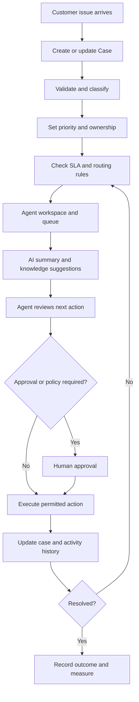

# ServicePilot
### Salesforce-Native AI Customer Service & Workflow Automation

> Resolve customer cases faster with governed automation, operational visibility, and context-aware AI assistance.

     

---

## The idea

Customer-service teams lose time switching between records, searching for answers, prioritizing queues, writing repetitive updates, and spotting cases that are about to breach a service-level agreement (SLA). Automation can help, but an AI assistant must not bypass permissions, business rules, or an agent’s judgment.

**ServicePilot is designed as a Salesforce-native service operations workspace** that brings the case lifecycle, operational visibility, and AI-assisted agent workflows together in one place.

> **Automate the repeatable work. Make the reasoning visible. Keep consequential decisions under control.**

This repository is the project blueprint and development home. Capabilities described as planned below are goals, not claims that they are already implemented.

## Product goals

- **One coherent case lifecycle:** capture, classify, prioritize, route, work, escalate, resolve, and close cases with explicit state transitions.
- **Operational visibility:** make queues, aging cases, SLA risk, workload, and resolution outcomes easy to understand.
- **Grounded AI assistance:** summarize case history, retrieve relevant approved knowledge, and suggest next steps using information available to the current user.
- **Governed automation:** enforce Salesforce access controls, validation, and business policies; require human approval for consequential actions.
- **Measurable improvement:** compare results against a documented baseline instead of presenting unverified metrics.

## End-to-end workflow



AI is an assistive layer, not an independent authority. Suggestions must be checked against case context and policy. Unsupported, unauthorized, ambiguous, or high-impact actions should be declined or escalated to a human.

## Planned capabilities

### 1. Case lifecycle and routing
- Define a consistent case state model and reject invalid transitions.
- Capture relevant category, priority, origin, product, account/contact context, owner, and resolution details.
- Route cases using explicit criteria such as category, priority, product, agent skill, or queue capacity.
- Use Salesforce Flow for declarative orchestration and Apex where reusable, bulk-safe logic is needed.
- Preserve a useful, auditable history of status changes and work performed.

### 2. SLA and escalation management
- Track response and resolution targets using an explicitly documented service policy.
- Surface approaching and breached targets, case age, and escalation status.
- Configure escalation ownership, notifications, and fallback paths.
- Test business hours, holidays, paused clocks, reopened cases, and priority changes where supported by requirements.

> SLA clocks need explicit definitions and tested boundary conditions. A dashboard indicator alone is not an SLA engine.

### 3. Lightning agent workspace
- Build Lightning Web Components (LWC) for queue views, case details, workload summaries, and SLA-risk indicators.
- Use Apex controllers for narrowly scoped, permission-aware data access when standard UI and Lightning Data Service are insufficient.
- Filter by priority, status, owner, age, and SLA condition.
- Provide clear loading, empty, error, and no-access states.
- Design for keyboard use, readable contrast, and responsive layouts.

### 4. Agentforce-assisted service

The intended AI experience focuses on three bounded tasks:

| Capability | Expected output | Control |
|---|---|---|
| Case summarization | Issue, relevant history, attempted fixes, blockers, and open questions | Clearly labelled AI draft for agent review |
| Knowledge retrieval | Relevant approved articles and troubleshooting guidance | Ground recommendations in accessible sources; never invent citations |
| Next-best-action suggestions | Recommended next step and supporting context | Agent review before consequential actions |

Use supported Agentforce capabilities and configured actions available in the target Salesforce org. Prompt instructions alone are not an authorization system: access checks, validation, and action-level controls must be enforced by platform configuration and server-side logic.

### 5. Analytics and operational insights
- Open cases by status, priority, product, and queue.
- Median and percentile resolution time, not only averages.
- First-response time and SLA attainment/breach rate.
- Case aging, escalation volume, and reopen rate.
- Workload distribution and AI-assistance adoption.
- Before/after comparison using defined windows and comparable case cohorts.

Every metric should specify its denominator, time window, exclusions, and source fields. Demo data must never be presented as production performance.

## Architecture

| Layer | Salesforce technology | Responsibility |
|---|---|---|
| Experience | Lightning App, Lightning Web Components | Agent workspace, queues, case actions, dashboards |
| Business logic | Apex classes and triggers when needed | Reusable policies, validation, bulk-safe service logic |
| Workflow | Salesforce Flow | Guided processes, routing and escalation orchestration, notifications |
| Data | Standard Case and related objects; custom objects only when justified | Cases, customer context, optional service policy and AI audit records |
| Query | SOQL | Selective, bounded queries through a permission-aware access path |
| AI | Agentforce and approved knowledge | Summaries, retrieval, recommendations |
| Security | Permission sets, sharing, CRUD/FLS checks, validation | Least privilege and permitted operations |
| Quality | Apex tests, configured LWC tests, sandbox/UAT scenarios | Regression protection and acceptance evidence |

### Conceptual request path

```text
Lightning UI (LWC)
       |
       v
Apex service/controller -----> Salesforce records (SOQL / DML)
       |                                |
       v                                v
Validation + authorization        Flows / record automation
       |
       v
Agentforce / approved knowledge (when configured)
       |
       v
Suggestion -> policy checks -> agent approval when required
       |
       v
Auditable case/activity update
```

This is a target architecture, not a claim about verified files in the repository. The final design should be refined against the data model, org features, and deployment constraints.

## Data model: starting point

Prefer standard Salesforce objects before introducing custom ones. Document and version the final schema.

| Entity | Purpose | Design considerations |
|---|---|---|
| Case | Primary customer issue | Status, priority, origin, subject, description, owner, account/contact and product context |
| Account / Contact | Customer context | Respect record-level and object-level access |
| Knowledge article | Approved support guidance | Ensure the agent and AI experience can access referenced content |
| Case comments / activities | Communication and work history | Avoid unnecessary duplication of sensitive information |
| Custom service policy (optional) | Configurable SLA/routing rules if standard configuration is insufficient | Effective dates, ownership, validation |
| AI interaction audit (optional) | Task type, status, references, and human outcome when justified | Minimize sensitive content; define retention and access |

Only add custom objects and fields when requirements justify them. Avoid duplicating capabilities already handled by standard Salesforce objects.

## Security, safety, and reliability

Security is a design requirement, not a later feature.

- **Least privilege:** use permission sets and sharing appropriate to each role; never assume every agent can read every case.
- **CRUD and field-level security:** enforce object and field access in Apex and the selected data-access path. Use user-mode operations or explicit checks appropriate to the chosen API and Salesforce version.
- **Record-level access:** use sharing-aware access patterns; document any elevated/system-context behavior and keep it narrowly scoped.
- **Server-side validation:** never rely on hidden buttons or client-side checks to enforce business policy.
- **Bulk safety:** design Apex for collections, governor limits, imports, and automation-triggered updates—not only one UI record.
- **AI boundaries:** treat customer text, attachments, and retrieved content as untrusted input; ignore embedded instructions that conflict with policy.
- **Human control:** require confirmation for sensitive communications, irreversible changes, credits/refunds, or other consequential actions unless an approved policy explicitly governs them.
- **Auditability:** capture meaningful state changes and decision outcomes without copying excessive personal or confidential data.
- **Graceful failure:** AI or automation failure must not lose case data or silently mark work complete.
- **Secret hygiene:** keep credentials and tokens out of source control; never commit real customer data.

## Success metrics

### Primary outcome target

**Target a 40% reduction in median case resolution time** against a defined baseline in a controlled evaluation.

This is a target, not an achieved result. Validate it before presenting it as a resume accomplishment or public performance claim.

### Evaluation plan
1. Establish a baseline using a representative set of comparable cases before enabling the workflow.
2. Define the case cohort, priority/category mix, business-hours policy, exclusions, and observation window.
3. Compare median and percentile resolution time for comparable cohorts; report sample size and caveats.
4. Track quality safeguards at the same time: reopen rate, escalation rate, SLA attainment, policy violations, and agent feedback.
5. Isolate AI value using a suitable control or predefined baseline instead of attributing every change to AI.
6. Publish the calculation method, limitations, and results in a reproducible evaluation note.

A faster closure is not a success if cases reopen more often or service quality declines.

## Development roadmap

This repository starts as a project blueprint. Update the checklist as work is implemented and verified.

- [ ] **Phase 1 — Foundation:** confirm requirements, target org, schema, permissions, naming conventions, and acceptance criteria.
- [ ] **Phase 2 — Case lifecycle:** implement validations, routing/assignment, and state transitions.
- [ ] **Phase 3 — SLA automation:** define clock semantics, risk states, escalation paths, and boundary-case tests.
- [ ] **Phase 4 — Agent workspace:** implement LWC components, Apex services, secure data access, and UI states.
- [ ] **Phase 5 — Agentforce:** configure grounded summaries, knowledge retrieval, and recommendations with permission and approval checks.
- [ ] **Phase 6 — Reporting:** build operational dashboards and reconcile metrics against source records.
- [ ] **Phase 7 — Quality and security:** add bulk, negative, permission, failure-mode, and regression tests.
- [ ] **Phase 8 — Evaluation and demo:** deploy to a sandbox/demo org, load synthetic records, capture a walkthrough, and report measured outcomes.

## Getting started

### Prerequisites
- A Salesforce Developer Edition or sandbox org with the features/licences required by the selected design.
- Salesforce CLI (`sf`) and an authenticated target org.
- A code editor with Salesforce extensions.
- Permissions to deploy metadata, run Apex tests, and configure Flows.
- Agentforce entitlements and configured Knowledge/actions if you plan to test AI features.

Exact permissions, licences, and Agentforce availability depend on the target Salesforce org. Confirm them before planning a deployment.

### Planned local workflow

After a Salesforce DX project structure and configuration are added, the expected workflow is:

1. Clone the repository.
2. Authenticate to a designated development or sandbox org.
3. Review the deployment manifest and target-org assumptions.
4. Deploy metadata to the sandbox.
5. Run Apex tests and documented smoke tests.
6. Configure required Flows, permissions, Knowledge, and Agentforce components.
7. Load synthetic seed data and verify the end-to-end workflow.

Typical Salesforce CLI commands, to use once the relevant project configuration and metadata exist:

```bash
git clone https://github.com/Sanjayram3269/servicepilot.git
cd servicepilot

# Authenticate to a sandbox or development org
sf org login web --alias servicepilot-dev --instance-url https://test.salesforce.com

# Run only after Salesforce DX configuration and metadata have been added
sf project deploy start --target-org servicepilot-dev
sf apex run test --target-org servicepilot-dev --wait 30
```

These commands describe the intended workflow and are not verified against repository files yet. Do not run the deployment commands until project configuration and metadata exist.

## Testing strategy

| Area | Minimum scenarios |
|---|---|
| Case lifecycle | Valid transitions; invalid transitions rejected; required resolution fields |
| Routing | Each rule’s expected owner/queue; missing or ambiguous criteria; fallback behavior |
| SLA | Within target, approaching target, breached target, business-hours boundaries, paused/reopened cases |
| Permissions | Authorized agent, inaccessible record, restricted field, insufficient object access |
| Apex | Empty input, single record, bulk record set, duplicate events, expected exceptions |
| AI assistance | Incomplete context, unavailable knowledge, unsupported suggestion, hostile instructions embedded in case text |
| UI | Loading, success, no results, error, no access, keyboard navigation |
| Resilience | AI/automation failure does not lose data or silently complete the task |
| Metrics | Reconcile dashboard values against source records and documented calculations |

Use synthetic or anonymized data. Report outcomes from actual test runs and document failures and known platform limitations.

## Demo narrative

A strong walkthrough should show one complete, realistic scenario:

1. A fictional customer issue enters Salesforce as a Case.
2. Validation and routing rules classify it and assign the correct queue.
3. The agent workspace highlights priority, age, and SLA status.
4. The AI assistant proposes a concise, context-grounded summary and relevant knowledge.
5. The agent reviews the next step; policy-sensitive actions require configured approval.
6. The agent resolves the case and records the outcome.
7. Operational metrics update, followed by the evaluation method and evidence.

Use fictional records and label seeded data. Do not present mock screens, future capabilities, or target metrics as production results.

## Proposed repository structure

```text
servicepilot/
├── README.md
├── sfdx-project.json
├── manifest/
│   └── package.xml
├── force-app/main/default/
│   ├── classes/
│   ├── triggers/
│   ├── lwc/
│   ├── flows/
│   ├── objects/
│   ├── layouts/
│   ├── permissionsets/
│   └── applications/
├── config/
├── docs/
│   ├── architecture.md
│   ├── data-model.md
│   ├── security-model.md
│   ├── testing-strategy.md
│   └── evaluation.md
└── scripts/
```

This is a proposed layout, not a statement that these directories already exist.

## Project status

**Current status: Blueprint / initial setup.**

The GitHub repository was empty when this README was prepared. No Salesforce implementation, deployment, Agentforce configuration, test results, live demo, or performance result is claimed here yet. As those artifacts become real, update the roadmap and add screenshots, a walkthrough, target-org requirements, and reproducible test/evaluation evidence.

## Contribution standards

For every change:
1. State the user problem and acceptance criteria.
2. Keep Apex bulk-safe and authorization close to data access.
3. Prefer standard Salesforce capabilities when they meet the requirement.
4. Add success, failure, permission, and edge-case tests.
5. Document metadata, permissions, Flow behavior, and org assumptions.
6. Update this README only when implementation or validated results change.

## License

No license has been selected yet. Until a `LICENSE` file is added, do not assume this repository grants permission to reuse, modify, or distribute its contents.

---

**ServicePilot — customer service automation that is measurable, permission-aware, and accountable.
